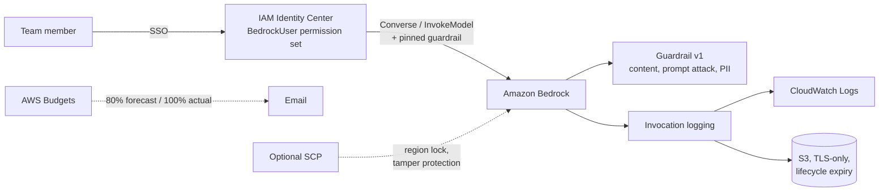

# bedrock-secure-access

Terraform for giving a team **access to Amazon Bedrock without losing control**: approved models only, a mandatory guardrail on every call, full invocation logging, and a spend alert — delivered through IAM Identity Center.

> Original reference implementation, written from scratch. It does not contain or derive from any client's environment.

## What it builds



| File | Resources |
|---|---|
| `access.tf` | `BedrockUser` permission set, inline policy, group assignment |
| `guardrail.tf` | Guardrail + immutable numbered version |
| `logging.tf` | S3 bucket, CloudWatch log group, logging role, invocation logging config |
| `budget.tf` | Monthly budget with forecast and actual alerts |
| `scp.tf` | Optional SCP (`enable_scp = true`) |

## What it prevents

| Risk | Control |
|---|---|
| Calling a model nobody approved | Allow only listed model / inference profile ARNs, plus an explicit `Deny` on everything else |
| Skipping the guardrail | `bedrock:GuardrailIdentifier` must equal the **pinned numeric version** — no guardrail, another guardrail, or `DRAFT` is denied |
| Weakening the guardrail by editing it | Users are denied `UpdateGuardrail` / `CreateGuardrailVersion`; IAM pins a version, so DRAFT edits don't take effect |
| Credentials leaking into prompts | Guardrail blocks AWS keys and passwords; masks email, phone and card numbers in responses |
| "Who sent what to the model?" | Every prompt and response logged to CloudWatch (search) and S3 (retention) |
| Someone turning logging off | Denied in the permission set; optionally in an SCP for every principal |
| Broader policy attached later | Explicit denies win over `AmazonBedrockFullAccess` or any other allow |
| Surprise bill | Budget alert at 80% forecast and 100% actual |

## Usage

Two accounts are assumed: the **workload** account where Bedrock runs, and the **management** (or Identity Center delegated admin) account. They can be the same.

```bash
cp terraform.tfvars.example terraform.tfvars   # edit values
terraform init
terraform plan
terraform apply
```

Get valid model and inference profile IDs for your region:

```bash
aws bedrock list-foundation-models --region ap-northeast-1 --query "modelSummaries[].modelId"
aws bedrock list-inference-profiles --region ap-northeast-1 --query "inferenceProfileSummaries[].inferenceProfileId"
```

Calls must include the guardrail:

```bash
aws bedrock-runtime converse \
  --model-id <allowed-model-or-profile-id> \
  --messages '[{"role":"user","content":[{"text":"Hello"}]}]' \
  --guardrail-config guardrailIdentifier=$(terraform output -raw guardrail_id),guardrailVersion=$(terraform output -raw guardrail_version)
```

## Verification

`tests/verify.sh` runs as the end user (BedrockUser credentials) and checks both what must work and what must fail:

```bash
aws sso login --profile bedrock-user
AWS_PROFILE=bedrock-user \
REGION=ap-northeast-1 \
ALLOWED_MODEL=<allowed-id> BLOCKED_MODEL=<not-allowed-id> \
GUARDRAIL_ID=$(terraform output -raw guardrail_id) \
GUARDRAIL_VERSION=$(terraform output -raw guardrail_version) \
./tests/verify.sh
```

Expected output:

```
PASS   allowed model + pinned guardrail (allow)
PASS   allowed model without guardrail (deny)
PASS   allowed model + DRAFT guardrail (deny)
PASS   model not on allow list + guardrail (deny)

passed: 4  failed: 0
```

Tamper protection is deliberately not tested live (a misconfiguration would delete the logging setup during the test). Check it with the IAM policy simulator against the permission set's role in the workload account: `bedrock:DeleteModelInvocationLoggingConfiguration` should be `explicitDeny`.

## Design notes

- **Cross-region inference needs two permissions.** An inference profile call is authorized on the profile ARN *and* on the foundation model in every destination region. `access.tf` builds both from `allowed_inference_profile_ids` and `inference_destination_regions`. The SCP region lock must include the destination regions too, or calls fail with a confusing AccessDenied.
- **Cross-region profiles need a cross-region guardrail.** Set `guardrail_profile_arn` when callers (such as Claude Code) use cross-region inference profiles.
- **Pin a numeric guardrail version.** Allowing the guardrail ID without a version lets anyone with edit rights change behaviour instantly. A new version is a reviewed Terraform change.
- **Invocation logging is per account and per region.** Deploy once per region you allow.
- **Logs contain prompts and responses.** Treat the bucket and log group as sensitive data; restrict read access separately and set `log_retention_days` to your policy.
- **Forecast alerts need history.** AWS Budgets only forecasts after some billing history exists, so on a new account the 100% actual alert is the one that fires first.
- **Check the budget's service names.** Some third-party model charges appear under their own service names in Cost Explorer. Look at your bill and add them to `budget_service_names`.

## Known limitations

- Guardrail input tags let a caller exclude parts of the prompt from input checks. The guardrail is always applied to the response.
- Don't grant this permission set `RetrieveAndGenerate`, `InvokeAgent` or `InvokeInlineAgent`: they make internal model calls without the guardrail and will hit AccessDenied. Use a separate role for Knowledge Bases and Agents.
- The guardrail and the caller must be in the same AWS Organization for cross-account use.

## Requirements

- Terraform >= 1.6, AWS provider ~> 6.69
- IAM Identity Center enabled, with an existing group for Bedrock users
- Model access granted in the Bedrock console for the models you allow

## License

MIT
